<p align="center">
  
</p>

<p align="center">
  <a href="https://www.linkedin.com/in/tripura-kanagala-a17942241"></a>
  <a href="mailto:tripurakanagala21@gmail.com"></a>
  <a href="https://github.com/Tripura21?tab=repositories"></a>
</p>

<!-- Optional: uncomment and edit when it applies
<p align="center"><b>🟢 Open to AI/ML Engineer roles</b> · 📍 YOUR CITY</p>
-->

## 🧠 About me

I build **LLM-powered systems that go beyond a chat box**: agents that plan and call tools, retrieval pipelines that ground answers in real documents, and the APIs and interfaces that ship them to users.

```python
class LakshmiTripura:
    role  = "AI/ML Engineer"
    focus = ["Generative AI", "LLMs", "RAG", "AI Agents", "MLOps"]

    stack = {
        "llms":      ["LangChain", "Ollama", "Gemini", "Hugging Face"],
        "retrieval": ["FAISS", "BM25", "cross-encoder reranking"],
        "serving":   ["FastAPI", "Docker", "Supabase / PostgreSQL"],
        "frontend":  ["React", "TypeScript", "Tailwind CSS"],
    }

    def what_i_care_about(self):
        return [
            "measuring retrieval quality, not guessing",   # Recall@K, MRR, faithfulness
            "agents that run in parallel and stream results",
            "turning prototypes into products people use",
        ]
```

## 🚀 Featured projects

<p align="center">
  <a href="https://github.com/Tripura21/PlanGenie"></a>
  <a href="https://github.com/Tripura21/enterprise-rag-assistant"></a>
</p>

<details>
<summary><b>Project details</b></summary>
<br>

| | Highlights |
|---|---|
| **[PlanGenie](https://github.com/Tripura21/PlanGenie)** | An orchestrator agent detects intent and runs flight, hotel and itinerary agents in parallel with `asyncio`, then streams each result over Server-Sent Events. It supports 7 conversational edit types ("swap day 2 and day 5 mornings") without regenerating the whole plan. |
| **[Enterprise RAG Assistant](https://github.com/Tripura21/enterprise-rag-assistant)** | Combines BM25 and dense (FAISS) retrieval, then reranks with a cross-encoder. Recall@5 went from 71% to 81% over a vector-only baseline on a 150-question evaluation set. |

</details>

## 🛠️ Tech stack

<table>
  <tr>
    <td><b>GenAI & LLMs</b></td>
    <td>
      
      
      
      
    </td>
  </tr>
  <tr>
    <td><b>Retrieval & Search</b></td>
    <td>
      
      
      
    </td>
  </tr>
  <!-- Uncomment the ML / data tools you actually use (delete the ones you don't):
  <tr>
    <td><b>ML & Data</b></td>
    <td>
      
      
      
      
      
      
    </td>
  </tr>
  -->
  <tr>
    <td><b>Backend & MLOps</b></td>
    <td>
      
      
      
      
      
    </td>
  </tr>
  <tr>
    <td><b>Frontend</b></td>
    <td>
      
      
      
      
    </td>
  </tr>
</table>

<!-- Add GitHub stats later, once your contribution graph has a few months of activity:
<p align="center">
  
  
</p>
-->

## 📫 Let's connect

I'm always happy to talk about **LLM applications, RAG evaluation and multi-agent systems**. Reach out on [LinkedIn](https://www.linkedin.com/in/tripura-kanagala-a17942241) or by [email](mailto:tripurakanagala21@gmail.com).

<p align="center">
  
</p>
